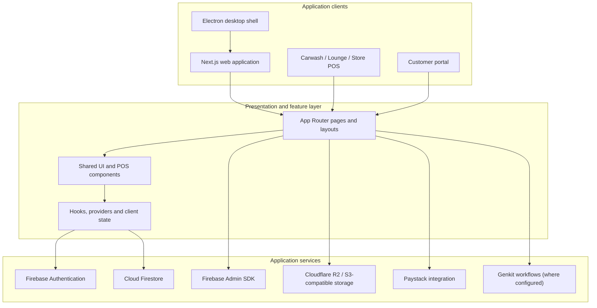
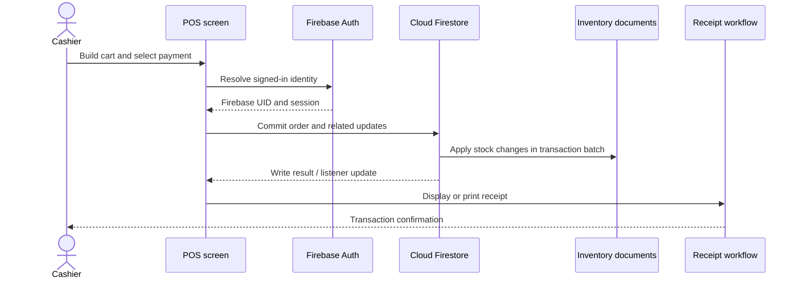

<div align="center">
  
  <h1>Urban Express · Business Operations Platform</h1>
  <p><strong>A unified point-of-sale and business management system for automotive services, hospitality, retail and multi-branch operations.</strong></p>
  <p>Built for day-to-day operations in Nakuru, Kenya, with a web application and Windows desktop distribution.</p>

  <p>
    <a href="https://github.com/Kmaina32/urban-address"></a>
    
    
    
    
    
    
    
    
  </p>
</div>

---

## Contents

- [Product overview](#product-overview)
- [Platform capabilities](#platform-capabilities)
- [Technology stack](#technology-stack)
- [System architecture](#system-architecture)
- [Application structure](#application-structure)
- [Data model and Firestore collections](#data-model-and-firestore-collections)
- [Core business workflows](#core-business-workflows)
- [Authentication, roles and access control](#authentication-roles-and-access-control)
- [Branch-aware operations](#branch-aware-operations)
- [POS hardware and desktop support](#pos-hardware-and-desktop-support)
- [Integrations and external services](#integrations-and-external-services)
- [Local development](#local-development)
- [Environment configuration](#environment-configuration)
- [Quality checks and testing](#quality-checks-and-testing)
- [Deployment](#deployment)
- [Operational and security guidance](#operational-and-security-guidance)
- [Contribution workflow](#contribution-workflow)

## Product overview

Urban Express is a unified business operations platform for a business that runs multiple service and sales environments. It brings front-counter transactions, stock control, staff operations, customer activity, financial reconciliation and management reporting into one application.

The platform is organized around three operating units:

| Operating unit | Main purpose | Primary workflows |
| --- | --- | --- |
| **Carwash & detailing** | Vehicle and carpet service operations | Vehicle intake, service selection, attendant assignment, queue progress, payment and job completion |
| **Lounge & bar** | Hospitality and table service | Table orders, product selection, held bills, kitchen preparation, payment and stock deduction |
| **Retail store** | Counter sales and product inventory | Product catalogue, barcode-assisted checkout, held carts, payment, receipts and stock deduction |

The wider management workspace supports employees, customers, branches, terminals, inventory, suppliers, expenses, register sessions, audit history and operational reporting. A customer-facing area provides access to the public catalogue and customer account workflows.

## Platform capabilities

### Point of sale

- Dedicated POS experiences for Carwash, Lounge and Store.
- Shared product, cart, payment, receipt and void-dialog components.
- Held bills that can be recalled and completed.
- Transaction records with cashier, terminal, payment and customer context where available.
- Sales history with status, search, date-range and business-unit filtering.
- Receipt preview and export/printing workflows.
- Checkout operations use Firestore writes/batches to keep related transaction and stock changes together.

### Carwash and detailing

- Vehicle and carpet job types.
- Vehicle identification fields including registration, make, model and colour.
- Service and attendant assignment.
- Job queue and service progress tracking.
- Attendant performance and commission-related data.
- Carwash-specific inventory and service reporting.

### Lounge and kitchen

- Table-oriented ordering.
- Lounge-specific product catalogue and stock.
- Held bills and order recall.
- Kitchen display workflow with preparation states such as new, preparing, ready and served.
- Transaction and inventory linkage.

### Retail and inventory

- Retail checkout and barcode-scanner workflow.
- Inventory catalogue organized by operating unit.
- Stock levels, minimum-stock thresholds and low-stock visibility.
- Product costing and stock valuation fields.
- Stock counts, adjustments, archival and inventory history tools.
- Supplier records and purchasing/stock management support.

### Management and administration

- Role-aware dashboard and administration areas.
- Employee and customer records.
- Branch and location management.
- POS terminal and register-session operations.
- Sales history, finance, reconciliation and petty-cash workflows.
- Audit-log views and database administration utilities.
- Reporting and business intelligence screens.
- Settings for business and receipt configuration.

### Customer experience

- Public landing and product catalogue.
- Customer registration and sign-in.
- Customer profile and order history.
- Product detail and customer order workflows.
- Contact and review experiences.

## Technology stack

The following reflects the dependencies and implementation currently present in the repository.

| Layer | Technology | Responsibility |
| --- | --- | --- |
| Web framework |  **Next.js 15 App Router** | Routing, layouts, pages, server/client rendering and application build |
| UI runtime |  **React 19** | Component model and interactive application state |
| Primary language |  **TypeScript** | Typed application models, component contracts and business logic |
| Additional language |  **JavaScript** | Electron main-process and supporting scripts |
| Styling |  **Tailwind CSS 3** | Utility-first responsive styling |
| UI primitives | **Radix UI + local shadcn-style components** | Accessible dialogs, menus, tabs, popovers, form controls and composable primitives |
| Icons | **Lucide React / Phosphor Icons** | Interface iconography |
| Motion | **Framer Motion / Motion** | Interface transitions and animation |
| Forms and validation | **React Hook Form + Zod + resolvers** | Form state and schema validation |
| Server-state utilities | **TanStack Query** | Query caching and asynchronous state where used |
| Database |  **Cloud Firestore** | Operational documents, live queries and realtime synchronization |
| Identity |  **Firebase Authentication** | User identity and sign-in |
| Privileged server operations | **Firebase Admin SDK** | Trusted server-side Firebase operations |
| Object storage |  **Cloudflare R2 via AWS S3-compatible SDK** | Object storage integration |
| Payments | **Paystack / react-paystack** | Payment authorization integration |
| Desktop runtime |  **Electron** | Windows desktop and kiosk packaging |
| Reporting/export | **ExcelJS, jsPDF, html2canvas** | Spreadsheet, PDF and document export |
| Maps | **Leaflet + React Leaflet** | Location and map interfaces |
| Charts | **Recharts** | Dashboard and reporting visualizations |
| Messaging bot | **Telegraf** | Telegram bot integration |
| AI/GenAI tooling | **Genkit + Google GenAI plugin** | AI workflow infrastructure present in the codebase; availability depends on configured flows and credentials |
| Testing | **Vitest, Testing Library, jsdom** | Unit/component test tooling |
| Hosting |  **Vercel** | Web application deployment and preview environments |

> Dependency presence does not mean every integration is enabled in every environment. Configure and verify the relevant credentials and workflows before relying on an external integration in production.

## System architecture

Urban Express uses a modular Next.js application with Firebase services as its managed backend.



### Architectural responsibilities

1. **Presentation:** App Router pages compose feature screens and shared components. Responsive layouts support desktop terminals, tablets and mobile devices.
2. **Feature logic:** Page-level workflows and reusable hooks coordinate user input, permissions, loading states and Firestore operations.
3. **Identity:** Firebase Authentication establishes the signed-in identity. The Firebase UID is the stable user identifier used by profile documents.
4. **Operational persistence:** Firestore stores operational records as documents in collections and nested subcollections. Snapshot listeners support realtime screens.
5. **Privileged operations:** Firebase Admin SDK is reserved for trusted server-side operations. Client-side UI checks are not a replacement for server authorization or Firestore Security Rules.
6. **External capabilities:** Storage, payments, maps, messaging and optional Genkit flows are integrated at feature boundaries rather than being the primary data store.

### Data flow: a POS checkout



The precise write set varies by operating unit and workflow. Financial and stock mutations must remain consistent with the corresponding order status and must not be repeated by retry or recall logic.

## Application structure

The repository follows a feature-oriented structure inside `src`.

| Path | Responsibility |
| --- | --- |
| `src/app/` | Next.js routes, layouts and page-level feature screens |
| `src/app/carwash/` | Carwash operations and POS |
| `src/app/lounge/` | Lounge POS and hospitality workflows |
| `src/app/store/` | Retail POS |
| `src/app/admin/` | Administration, branch management, database tools and live operational controls |
| `src/app/client/` | Customer-facing account, catalogue and order pages |
| `src/components/ui/` | Reusable UI primitives and composed controls |
| `src/components/pos/` | POS-specific cart, payment, receipt, terminal and workflow components |
| `src/components/layout/` | Application shell, navigation and headers |
| `src/components/admin/` | Shared administration components and live statistics |
| `src/components/reports/` | Reporting controls and report-specific components |
| `src/components/shared/` | Shared cross-feature components such as maps and location pickers |
| `src/firebase/` | Firebase initialization, providers, auth hooks and Firestore hooks |
| `src/hooks/` | Reusable stateful hooks for profiles, terminals, business time, scanners and settings |
| `src/lib/` | Shared domain types, utilities, exports, hardware and service helpers |
| `src/ai/` | Genkit development entry point and AI workflow infrastructure |
| `src/desktop/` | Electron main-process code |
| `public/` | Static assets, including the official application logo |
| `firestore.rules` | Firestore authorization rules |
| `firestore.indexes.json` | Firestore composite index definitions |
| `firebase.json` | Firebase CLI configuration |
| `package.json` | Scripts, runtime dependencies and Electron Builder configuration |

### Component architecture

The interface is assembled from three levels:

- **Design primitives:** buttons, inputs, labels, dialogs, dropdowns, tabs, cards, tables, badges and other reusable controls under `src/components/ui`.
- **Domain components:** POS product cards, cart rows, payment views, receipt preview, void dialogs, terminal controls, customer lookup and reporting components.
- **Feature pages:** route-level screens that combine domain components with hooks, user/profile context and Firestore queries.

Shared POS components are intended to keep the three tills consistent while allowing each business unit to retain its own catalogue, service logic and checkout requirements. A feature should reuse an existing shared component where the interaction is genuinely common; business-specific rules should remain in the owning feature.

## Data model and Firestore collections

Cloud Firestore is a document database, not a relational SQL database. The terms **collection**, **document**, and **subcollection** are used below. The tables are a developer-facing map of the domain model, not a promise that every optional field is populated in every historical document.

### Main collections

| Collection / path | Purpose | Typical document data |
| --- | --- | --- |
| `users/{uid}` | Staff and customer profiles keyed by Firebase UID | Name, email, role, assigned units, branch access, active branch, contact details and profile metadata |
| `admins/{email}` | Additional administrator whitelist records | Admin identity/authorization metadata |
| `branches/{branchId}` | Business branch directory | Branch name/code, status, primary flag, address, town, county, coordinates and audit metadata |
| `orders/{orderId}` | Transaction and order lifecycle master records | Unit/type, status, total, items, payment method, cashier, terminal, customer, timestamps and service details |
| `inventory/{productId}` | Shared product and stock catalogue | Name, category, unit, price, stock level, minimum stock, barcode, cost and archival/count fields |
| `carwash_jobs/{jobId}` | Carwash/carpet operational job records | Linked order, vehicle details, service, attendant, commission, price and job status |
| `audit_logs/{logId}` | Security and operational audit trail | Actor, action, details, severity, terminal and timestamp |
| `suppliers/{supplierId}` | Supplier directory | Supplier name, contact person, phone, email, category and status |
| `inventory_backups/{backupId}` | Inventory backup/history snapshots | Snapshot data and timestamp |
| `register_sessions/{sessionId}` | Register cash session lifecycle | Terminal, manager, opening/closing cash, timestamps and status |
| `live_audio_sessions/{sessionId}` | Admin-controlled live audio session requests | Requesting admin, cashier, terminal and session status |

### Nested and related paths

| Path pattern | Purpose |
| --- | --- |
| `users/{uid}/held_bills/{billId}` | Cashier-scoped copy/index of a held bill for recall |
| `users/{uid}/ai_chats/{chatId}` | User-scoped AI conversation history where the feature is configured |
| `live_audio_sessions/{sessionId}/staff_candidates/{candidateId}` | Candidate/connection records for the staff side of an approved audio session |
| `live_audio_sessions/{sessionId}/admin_candidates/{candidateId}` | Candidate/connection records for the admin side of an approved audio session |

Other feature-specific records may exist in the live database and should be checked against the feature implementation and deployed rules before being added to or removed from this map.

### Core TypeScript domain models

Shared interfaces and unions are maintained in `src/lib/types.ts`. Important models include:

| Model | Meaning |
| --- | --- |
| `UserProfile` | Application profile, role and branch assignment data |
| `UserRole` | `ADMIN`, `MANAGER`, `SUPERVISOR`, `CASHIER`, `STOREKEEPER`, `ATTENDANT`, `KITCHEN`, `CLIENT` |
| `BusinessBranch` | Branch identity, location and lifecycle |
| `BusinessUnit` | `LOUNGE`, `STORE`, `CARWASH` |
| `Product` | Product, pricing, stock and costing information |
| `Order` / `OrderItem` | Order lifecycle, payment totals and line items |
| `CarwashJob` | Vehicle/carpet service work item |
| `POSTerminal` | POS terminal and current operator/session references |
| `RegisterSession` / `CashierSession` | Register and cashier shift/session data |
| `AuditLog` | Traceable operational/security event |
| `Supplier` | Supplier contact and status |
| `PettyCashRequest` | Petty cash request and approval lifecycle |
| `Reconciliation` | Expected-vs-actual cash reconciliation |

### Order lifecycle

The `Order.status` union currently models:

- `PENDING` — held or otherwise awaiting completion.
- `PAID` — completed paid transaction.
- `VOIDED` — voided transaction.
- `REFUNDED` — refunded transaction.
- `PARTIALLY_REFUNDED` — partially refunded transaction.

Kitchen preparation is represented separately through `prepStatus` (`NEW`, `PREPARING`, `READY`, `SERVED`). Carwash jobs have their own operational status (`QUEUED`, `IN_PROGRESS`, `COMPLETED`, `CANCELLED`).

A held bill has both a cashier-scoped recall record and a master order record. Recalling and completing an existing held bill must update the original master order rather than create a second paid order. This preserves the transaction identity and prevents a stale pending record from remaining in the backlog. Purge operations must be restricted to selected pending records and must not delete paid sales history.

### Inventory relationship

Orders contain line-item snapshots so historical receipts retain the product name, price and quantity charged at checkout. Inventory documents hold the current stock state. A checkout that consumes stock must update the relevant inventory document(s) as part of the same logical write operation as the order. Do not reconstruct historical sales from current product prices or overwrite current stock with an old receipt snapshot.

### Branch relationship

Branch records are stored separately from user profiles. Staff profiles can carry `branchIds` and an `activeBranchId`. Branch-aware queries and writes should use the assigned/active branch context where that feature supports it. The existing business is initialized around the default **Naka Branch**; new branches are added through the admin branch-management workspace.

Legacy records may not all contain branch identifiers. Treat missing branch metadata as legacy/unassigned data and handle it deliberately; do not silently expose or move records across branches.

## Core business workflows

### Held bill to paid sale

1. A cashier builds a cart and parks/holds it.
2. The application stores the master order in `orders/{orderId}` with a pending status.
3. A cashier-scoped copy is stored under `users/{uid}/held_bills/{orderId}` for convenient recall.
4. On recall, the POS restores the existing order and its original identity.
5. Checkout updates the original master order to its completed status and applies related stock/payment changes.
6. The held-bill copy is removed after successful completion.

### Inventory and checkout

- Product catalogue data is read from the shared inventory collection and filtered by operating unit.
- The cart retains the transaction-time product details.
- Successful checkout records the order and performs the corresponding stock mutation.
- Inventory adjustments and stock counts should be auditable and should preserve the distinction between counted stock, system stock and historical transaction quantities.

### Register and cashier sessions

Register sessions track opening and closing cash for a terminal. Cashier sessions identify the operator assigned to a terminal/register period. Session identity should remain linked to the authenticated user and should be included in transaction metadata when available.

### Finance and reconciliation

Finance workflows include cash reconciliation, petty cash requests and operational expense-related controls. A reconciliation compares expected cash with actual cash and records the variance and outcome. Sensitive approvals and adjustments should be role-gated and leave an audit trail.

## Authentication, roles and access control

Firebase Authentication is the identity provider. The application profile is stored at `users/{firebaseUid}`; the Firebase UID is the stable link between authentication and application data.

The application role model includes:

| Role | General responsibility |
| --- | --- |
| `ADMIN` | Full operational administration |
| `MANAGER` | Management and approval workflows |
| `SUPERVISOR` | Supervisory controls and approvals |
| `CASHIER` | POS checkout and cashier workflows |
| `STOREKEEPER` | Inventory and stock operations |
| `ATTENDANT` | Carwash service execution |
| `KITCHEN` | Kitchen display and preparation workflow |
| `CLIENT` | Customer-facing account and order workflows |

Authorization is implemented across the application and Firestore Security Rules. The rules define signed-in, staff, admin, super-admin, kitchen and record-ownership checks, with specific restrictions for sensitive live-audio session operations and client-created orders.

**Security principles**

- Keep Firebase Authentication as the identity source of truth.
- Never treat hidden buttons or client-side role checks as security boundaries.
- Enforce access in Firestore Security Rules and trusted server-side code.
- Never store plaintext passwords, PINs, service-account keys or private credentials in source control.
- Keep service-account credentials and payment secrets in secure environment configuration.
- Restrict destructive actions and sensitive financial changes to authorized roles.
- Write meaningful audit records for privileged or financially sensitive operations.

## Direct administrator access

Customer sign-up grants immediate authenticated access without an email verification gate. Similarly, administrator sign-in directs verified administrators straight into the staff portal and executive dashboard (`/dashboard`) immediately upon password authentication. Intermediate daily OTP codes, lockouts and verification screens have been completely removed.

## Branch-aware operations

The platform supports a single business operating more than one physical branch.

- The branch directory stores branch code, name, status and physical location.
- The initial location is represented as the default **Naka Branch**.
- Administrators can create and manage additional branches.
- User profiles can store branch access through `branchIds` and the current working branch through `activeBranchId`.
- POS, inventory, sales, reporting and staff workflows should retain branch context as those records are created and queried.

When extending a feature, review its query, write payload, report aggregation and security rules together. A branch selector alone is not sufficient: the branch identifier must flow consistently through the underlying records and access checks. Older records without branch metadata require an explicit legacy-data policy.

## POS hardware and desktop support

The web POS is designed to work with common counter hardware. The repository includes a hardware service and barcode-scanner hooks, as well as an Electron desktop entry point.

| Hardware / runtime | Integration approach |
| --- | --- |
| USB barcode scanner | Keyboard/HID-style scanner input through the barcode-scanner workflow |
| Thermal receipt printer | Receipt formatting and the existing local print-service workflow |
| Cash drawer / register peripherals | Device-dependent terminal and local hardware integration |
| Desktop kiosk | Electron wrapper with application icon and Windows packaging |
| Location hardware | Browser/device location capabilities used by location features where permission is granted |

The Electron app is configured through `package.json` and `src/desktop/main.js`. Its product name is **Urban Business OS** and its Windows installer uses the official logo at `public/assets/logo.png`.

Browser permissions (such as location, microphone or notifications) must be requested in context, explained to the operator and handled with clear success, denied and retry states. Do not assume a permission has been granted simply because a dialog was opened.

## Integrations and external services

| Service / package | Intended use | Configuration note |
| --- | --- | --- |
| Supabase Auth | User sign-in, session refresh, and identity | Configure Supabase URL, publishable anon key, and redirect URLs |
| Supabase PostgreSQL & Realtime | Application data, RLS policies, and realtime subscriptions | Apply SQL migrations in `supabase/migrations/` |
| Supabase Service Role | Trusted server-side operations and admin APIs | Use `SUPABASE_SERVICE_ROLE_KEY` on the server only |
| Cloudflare R2 | Object/file storage | Use S3-compatible endpoint and credentials; never expose secret keys in client bundles |
| Paystack | Payment authorization | Configure public and secret credentials according to the payment flow |
| Genkit / Google GenAI | AI workflow infrastructure | Enable only the flows actually required and configure server-side credentials |
| Telegram / Telegraf | Bot messaging workflows | Store bot token securely |
| Leaflet | Map and location interfaces | Configure tile provider and attribution as required |

External service availability, quotas, callback URLs and account-level setup are separate from the application build. A local build does not prove that a live payment, storage upload, map tile or messaging integration is correctly configured.

## Local development

### Prerequisites

- Node.js compatible with the repository's Next.js 15 toolchain.
- npm.
- Access to the Supabase project used by the environment.
- Required environment variables for the features you intend to run.
- Optional credentials for R2, Paystack, Resend, Genkit and Telegram integrations.

### Bootstrap first super-admin

```bash
node scripts/bootstrap-admin.mjs
```

### Install dependencies

```bash
git clone https://github.com/Kmaina32/urban-address.git
cd urban-address
npm install
```

### Start the web application

```bash
npm run dev
```

Open [http://localhost:3000](http://localhost:3000).

### Available scripts

| Command | Purpose |
| --- | --- |
| `npm run dev` | Start Next.js development server on port 3000 |
| `npm run build` | Create a production Next.js build |
| `npm run start` | Start the production server |
| `npm run typecheck` | Run TypeScript without emitting files |
| `npm run test` | Run Vitest |
| `npm run desktop:dev` | Launch the Electron desktop shell |
| `npm run desktop:build` | Build the web app and package the Electron desktop app |
| `npm run genkit:dev` | Start the Genkit development entry point |
| `npm run genkit:watch` | Start the Genkit development entry point in watch mode |

The `lint` script is defined in the package manifest; confirm compatibility with the installed Next.js CLI before using it as a CI gate.

## Environment configuration

The exact variables depend on the enabled features and deployment environment. Keep a local `.env.local` file out of version control and configure production values in the hosting provider's encrypted environment settings.

Typical configuration areas include:

| Configuration area | Required / expected variables |
| --- | --- |
| Supabase client | `NEXT_PUBLIC_SUPABASE_URL`, `NEXT_PUBLIC_SUPABASE_ANON_KEY` |
| Supabase server & DB | `SUPABASE_SERVICE_ROLE_KEY`, `DATABASE_URL`, `DATABASE_URL_MIGRATIONS` |
| Cloudflare R2 | Account endpoint, bucket, access key ID and secret access key |
| Paystack | Public key for client integration and secret key for trusted server operations |
| Resend | `RESEND_API_KEY` for transactional emails and password reset delivery |
| Genkit | Google AI / Genkit credentials and model configuration |
| Telegram | Bot token and webhook configuration |

See `.env.example` for the complete list of environment variables expected by the application.

## Quality checks and testing

Before opening a pull request, run the checks relevant to the change:

```bash
npm run typecheck
npm run test -- --run
npm run build
```

For POS, inventory and finance changes, also perform a manual workflow review:

- Complete a sale in each POS unit.
- Verify the order record and receipt details.
- Verify the stock movement and current inventory value.
- Hold a bill, recall it and complete it; confirm the original order reference is retained.
- Confirm paid sales are not included in pending-backlog purge operations.
- Verify cashier, terminal and branch attribution where applicable.
- Check mobile and desktop layouts.
- Check authorization with the intended role and an unauthorized role.
- Confirm errors are visible and do not silently appear as empty data.

Automated test coverage may vary by feature. Report which checks actually ran; do not treat a successful build as proof that every business workflow is correct.

## Deployment

The web application is deployed through Vercel. The repository is connected to GitHub, allowing branch preview deployments and production deployments from the configured production branch.

Recommended release sequence:

1. Create a focused feature or documentation branch from the current `main`.
2. Implement the change and keep the diff scoped.
3. Run type checking, relevant tests and a production build.
4. Open a pull request and inspect the changed files and preview deployment.
5. Verify critical workflows in the preview environment.
6. Merge only after review/approval.
7. Confirm the production deployment and monitor runtime errors.

Firebase rules and indexes are separate deployable resources. When they change, review and deploy them intentionally using the Firebase CLI and the correct project:

```bash
firebase deploy --only firestore:rules,firestore:indexes
```

Do not deploy rules or indexes to an unintended Firebase project.

## Operational and security guidance

- **Data integrity:** Keep order state, stock mutations and payment outcomes consistent. Prefer atomic Firestore batches/transactions for related writes and design retry-sensitive operations to be idempotent.
- **Auditability:** Record who performed sensitive actions, when they occurred and what changed.
- **Least privilege:** Give each role only the access needed for its work. Re-check both client logic and Firestore rules when adding a role or collection.
- **Branch isolation:** Carry branch identifiers through writes, queries, exports and authorization checks. Do not assume old records belong to the currently selected branch.
- **Secrets:** Never commit Firebase service-account JSON, private keys, payment secrets, bot tokens or R2 credentials. Rotate credentials immediately if they are exposed.
- **Backups:** Maintain and test a recovery process for Firestore data and important stored objects. A backup feature is not useful until restoration has been tested.
- **Financial records:** Avoid destructive edits to paid orders. Use controlled void/refund/adjustment workflows and retain the original transaction history.
- **Permissions:** Explain hardware/browser permission requests and provide a clear route to retry when access is denied.

## Contribution workflow

- Keep pull requests focused and describe the business impact.
- Preserve established POS workflows and shared component contracts.
- Reuse existing components and domain types before introducing duplicates.
- Update Firestore rules, indexes, types and documentation when changing the data model.
- Include mobile and desktop verification for user-facing screens.
- Include migration and legacy-record handling notes for schema or branch changes.
- Never merge a pull request without explicit approval from the repository owner.

---

<div align="center">
  
  <p><strong>Urban Express · Business Operations Platform</strong></p>
  <sub>Operations, transactions and service delivery in one workspace.</sub>
</div>


## Admin email activity and inbound responses

The Admin → Email Communications page records each recipient delivery separately and displays Resend delivery events (sent, delivered, delayed, bounced, complained, opened and clicked). Incoming replies are stored in the Responses tab.

Production setup:
1. Add `RESEND_WEBHOOK_SECRET` to Vercel for the Resend webhook signing secret (the value beginning with `whsec_`). Keep it server-side; never expose it in client variables.
2. In Resend, create a webhook pointing to `https://<your-production-domain>/api/webhooks/resend`.
3. Subscribe to the email events: `email.sent`, `email.delivered`, `email.delivery_delayed`, `email.bounced`, `email.complained`, `email.opened`, `email.clicked`, and `email.received`.
4. To receive replies, configure a Resend receiving domain/address and its MX records. Use an address on a dedicated inbound subdomain if the domain already handles business mail elsewhere; do not replace existing MX records without checking the current mail provider.
5. Send a controlled test email, confirm its delivery event appears, then reply to the configured receiving address and confirm the message body appears in Responses.

Resend's `email.received` webhook contains metadata only. The server retrieves the full message body through the Resend Receiving API before storing it. The webhook verifies Svix signatures and ignores duplicate event IDs. Email activity and reply collections are server-managed; browser Firestore access remains denied.
