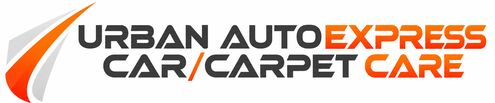

  
   
  <h1>URBAN EXPRESS | Unified Business OS</h1>
  
<strong>Enterprise-grade Management, POS & Intelligence System</strong>

  
<em>Optimized for Premium Hospitality and Automotive Operations in Nakuru, Kenya.</em>

---

## 🛠 Tech Stack & Core Dependencies

The OS is built on a high-fidelity, zero-trust architecture designed for speed, security, and real-time synchronization.

### Frontend
- **Framework**: Next.js 15 (App Router)
- **Library**: React 19
- **Styling**: Tailwind CSS + Shadcn UI
- **State Management**: **TanStack Query (React Query)** for high-density server state synchronization.
- **Animations**: Framer Motion & Motion

### Backend & Infrastructure
- **Database/Auth**: Firebase Firestore & Firebase Authentication
- **Server Core**: Firebase Admin SDK (Privileged operations)
- **Cloud Storage**: Cloudflare R2 (Global asset edge delivery)
- **AI Engine**: Google Genkit (Gemini 2.5 Flash) for forensic risk auditing and BI.
- **Payments**: Paystack API (M-Pesa, Card, Bank)

### Hardware & Desktop
- **Runtime**: Electron (Windows/Kiosk deployment)
- **Peripherals**: QZ Tray & Direct Web Serial (Thermal Printing, HID Scanners, Magnetic Readers)
- **Reporting**: ExcelJS & jsPDF (Digital audit forms and financial summaries)

---

## 📦 Key Libraries

| Dependency | Purpose |
| :--- | :--- |
| `@tanstack/react-query` | Server-state caching and asynchronous data fetching. |
| `@genkit-ai/google-genai` | Neural interface for AI-driven business intelligence. |
| `firebase` | Real-time database and identity management. |
| `react-paystack` | Secure multi-channel payment authorization. |
| `@aws-sdk/client-s3` | Infrastructure link for Cloudflare R2 object storage. |
| `telegraf` | Core engine for the Telegram Management Bot. |
| `esc-pos-encoder` | Character-aligned thermal receipt formatting. |
| `leaflet` | Geofencing and coordinate mapping for valet services. |

---

## 🚀 Core Modules

### 1. Detailing & Carwash Command
Real-time service queue with vehicle identification (Plate, Make, Model & Color), automated attendant commission logic, and valet tracking.

### 2. Lounge & Bar POS
High-speed touch interface for visual table management and liquid inventory tracking with integrated silent thermal printing.

### 3. Retail Store POS
Barcode-driven accessories sales with industrial-grade HID scanner support and automated atomic stock depletion.

### 4. Neural Intelligence Node
AI-powered fraud detection and business analytics using Gemini 2.5. Consult the system via natural language for sales trends and inventory forecasting.

### 5. Financial Treasury
Shift reconciliation with blind-drop cash counting, petty cash workflows, and automated variance auditing.

---

## 🔐 Security Standards
- **RBAC**: Role-Based Access Control enforced on every data node.
- **Geofencing**: POS operations restricted to the authorized physical workplace boundary.
- **Zero-Trust**: All financial transactions generate non-repudiable audit logs and require secondary supervisor authorization for high-risk actions.

---

*Driven by Precision • Urban Express Engineering | Nakuru, Kenya*
